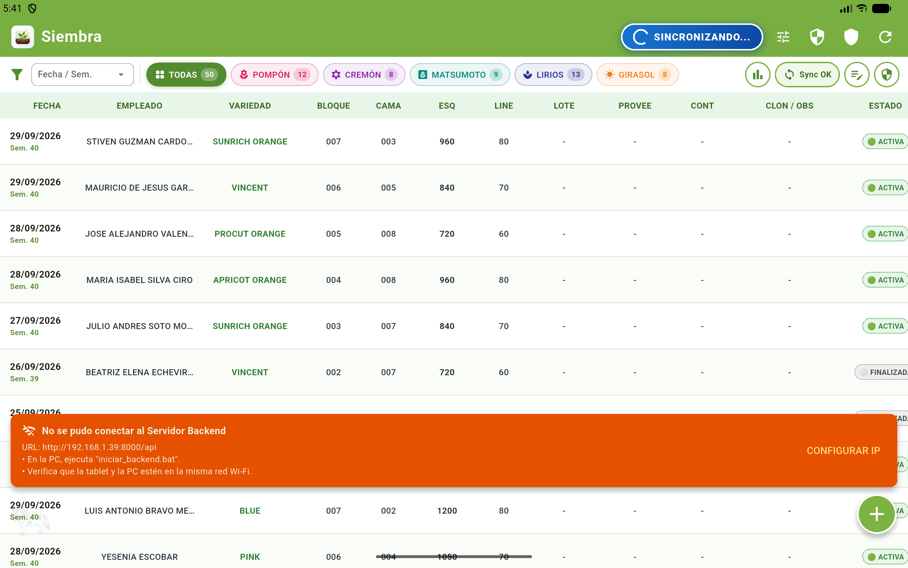
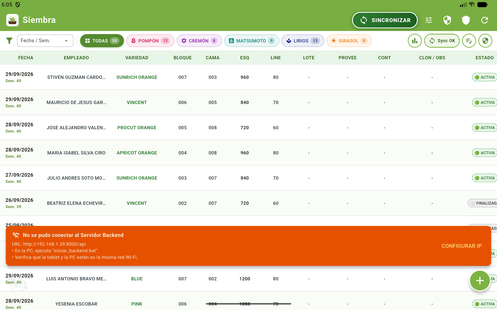
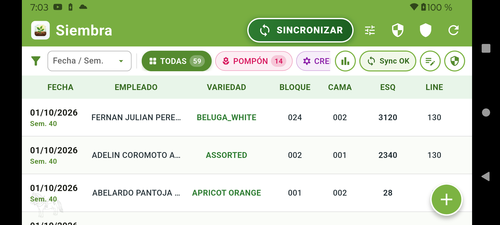
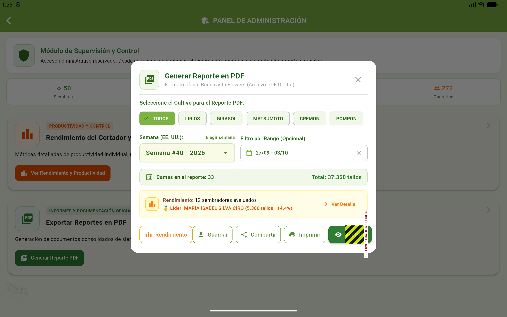
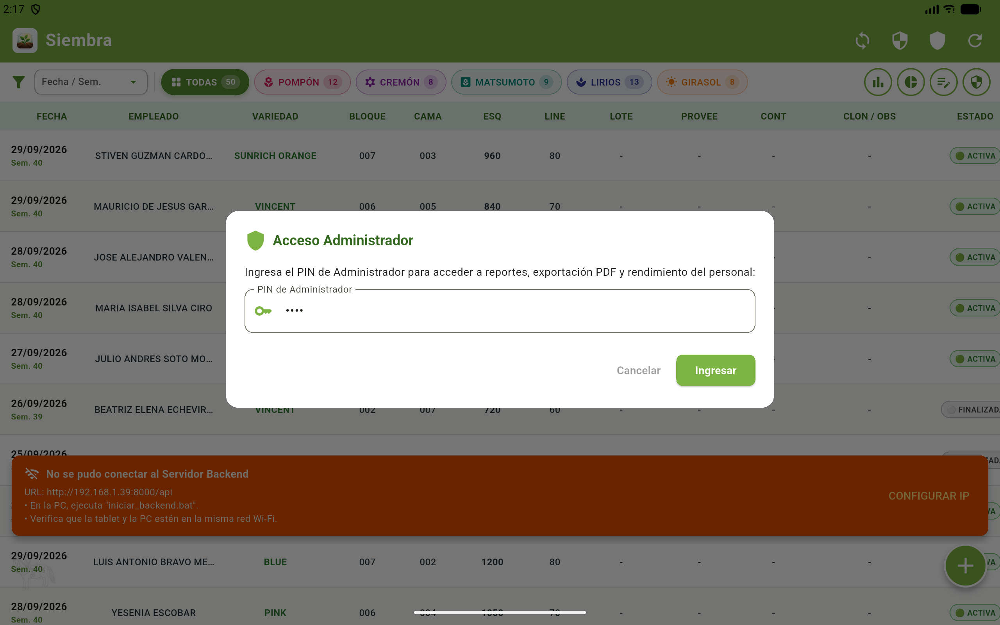
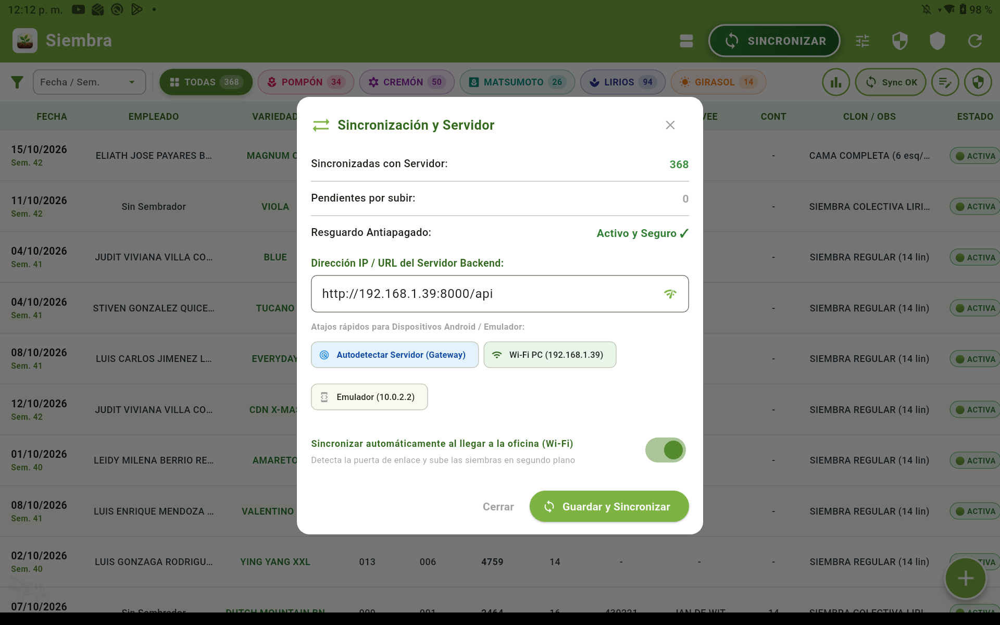
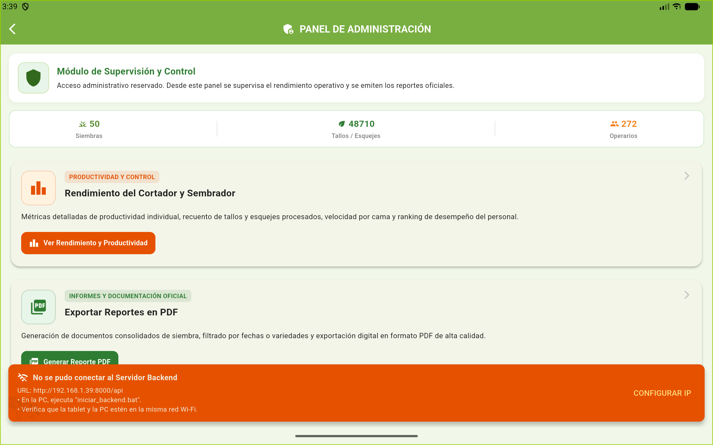
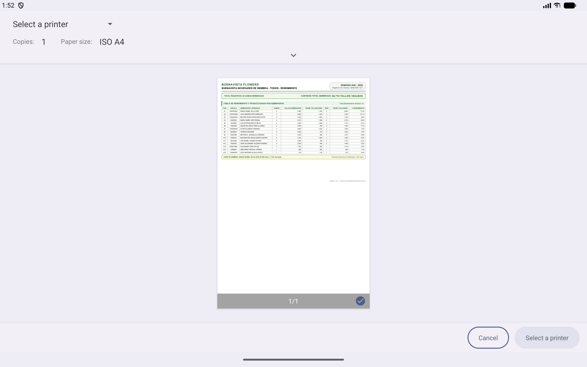

# MANUAL DE USUARIO OFICIAL Y GUÍA OPERATIVA PASO A PASO
## SISTEMA INTEGRAL DE REGISTRO DE SIEMBRAS EN CAMPO (OFFLINE-FIRST)
### *Versión Híbrida 2.0: Conectividad Dual (IP Manual + Autodescubrimiento por Gateway y Faro UDP)*

---

```
========================================================================================
            SISTEMA DE GESTIÓN Y CONTROL DE SIEMBRAS EN CAMPO
       Empresa Agrícola Floricultora - Finca La Valvanera / Siembras 2026
========================================================================================
Dispositivos Soportados: Tablets Android (Lenovo / Motorola) en Invernadero
Servidor Central: PC de Oficina (FastAPI + Microsoft Access bmempresarial2021.accdb)
Modo de Operación: 100% Offline en Campo + Sincronización Híbrida Dual al entrar a Oficina
========================================================================================
```

---

## 1. INTRODUCCIÓN Y ARQUITECTURA DE FUNCIONAMIENTO DUAL

Este sistema fue diseñado específicamente para trabajar en las condiciones reales de los bloques e invernaderos de floricultura:
1. **En los Invernaderos (Campo)**: No hay cable de red ni cobertura de Wi-Fi. La tablet opera **100% desconectada (Offline)**, permitiendo registrar siembras, validar cupos agronómicos, dividir camas y controlar rendimientos con cero retrasos.
2. **Resguardo Antiapagado (Cero Pérdida de Datos)**: Cuenta con un motor de respaldo atómico en espejo (`siembras_respaldo_persistente.json`, `sembradores_activos_persistente.json`). **Si la tablet se queda sin batería, se apaga o se borra el caché, los datos de las siembras y los sembradores seleccionados se recuperan intactos.**
3. **Conectividad Dual Híbrida (Ambos Sistemas Activos en Simultáneo)**:
   - **Sistema Anterior (Manual / Tradicional)**: Mantiene la IP estática configurada (`192.168.1.39:8000`), el botón manual "SINCRONIZAR" en la barra superior, la prueba de conexión y el diálogo de configuración rápida.
   - **Sistema Nuevo (Autónomo e Inteligente)**: Al entrar a la oficina con la tablet, el monitor de red detecta el Wi-Fi de la empresa, escucha el **Faro UDP (Puerto 8001)** y sondea la puerta de enlace (Gateway). Si la IP del PC de la oficina cambió, la tablet la descubre sola y sincroniza los datos en segundo plano sin interrumpir al operario.

---

## 2. EL DASHBOARD PRINCIPAL (PANTALLA DE CONTROL)

La pantalla principal es el centro de operaciones del supervisor. A continuación se detalla cada componente y exactamente **qué pasa cuando tocas o mueves cada elemento**:



### 2.1 Barra Superior (AppBar)

* **Título y Resumen Superior**: Muestra la fecha de trabajo actual y el conteo de siembras del día.
* **Botón `SINCRONIZAR (X)` (Fondo Verde con Alerta Naranja)**:
  - **¿Qué significa el número entre paréntesis?**: Indica cuántas siembras se han registrado en el campo que **aún no se han enviado a la oficina**. Por ejemplo, `SINCRONIZAR (4)` significa que hay 4 siembras guardadas en la tablet listas para transferir.
  - **¿Qué pasa si lo tocas?**:
    1. Si estás conectado al Wi-Fi de la oficina: Inicia de inmediato la subida de datos. La barra cambia a *"Sincronizando con Servidor Empresarial..."*. Al terminar, muestra un aviso verde: *"Sincronización Completa (X Variedades, Y Camas) ✓ Conectado a: http://..."* y el contador vuelve a `(0)`.
    2. Si estás lejos en el invernadero sin Wi-Fi: Muestra un aviso flotante claro informando que el servidor no responde y ofreciendo el botón directo para revisar la IP si fuese necesario.
* **Icono de Escudo / Engranaje (Panel de Administración)**:
  - **¿Qué pasa si lo tocas?**: Solicita el PIN de seguridad del supervisor. Al ingresar el PIN correcto, se abre el Hub Administrativo donde puedes gestionar los sembradores activos del día, auditar tablas y forzar restauraciones de seguridad.
* **Icono de Impresora / Documento (Generación de Planillas PDF)**:
  - **¿Qué pasa si lo tocas?**: Abre el generador de reportes en PDF listo para imprimir o enviar por WhatsApp con todas las firmas y detalles agronómicos.

---

### 2.2 Pestañas de Filtro por Variedad de Flor

En la parte superior encontrarás las pestañas horizontales:
`[ TODAS ]  [ POMPÓN ]  [ CREMÓN ]  [ MATSUMOTO ]  [ LIRIOS ]  [ GIRASOL ]`

* **¿Qué pasa si tocas una pestaña específica (ej. POMPÓN)?**:
  La lista de abajo se filtra inmediatamente para mostrar únicamente las siembras de esa flor. Las demás se ocultan temporalmente de la vista pero siguen seguras en la base de datos.
* **¿Qué pasa si tocas "TODAS"?**:
  Se restablece la vista completa mostrando todas las siembras cronológicamente.

---

### 2.3 Tarjeta de Cada Siembra Registrada

Cada siembra realizada aparece en una tarjeta informativa detallada:



* **Icono de Nube con Flecha (Naranja)**: Significa que la siembra está guardada en la tablet pero **pendiente por subir a la oficina**.
* **Icono de Chulito Verde (Check)**: Significa que la siembra ya fue recibida formalmente por el computador de la oficina y tiene su asiento en Microsoft Access.
* **Etiqueta de Bloque y Cama**: Muestra la ubicación precisa (ej. `Bloque 12 - Cama 08 Lado A`).
* **Etiqueta de Variedad y Esquejes**: Muestra el nombre comercial de la flor y la cantidad de tallos o bulbos plantados.
* **Botón de Modificar (Lápiz Azul)**:
  - **¿Qué pasa si lo tocas?**: Abre el formulario cargado con todos los datos de esa siembra para corregir si el operario digitó mal un número o se equivocó de sembrador.
* **Botón de Anular / Eliminar (Basurero Rojo)**:
  - **¿Qué pasa si lo tocas?**: Muestra una ventana de advertencia: *"¿Seguro que deseas anular esta siembra?"*. Al confirmar, la siembra se retira de la tablet y se crea un registro de cancelación automática para que, en la próxima sincronización, la oficina también la anule en Microsoft Access.

---

### 2.4 Botón Flotante Verde Redondo `(+)`

Ubicado en la esquina inferior derecha de la pantalla:
* **¿Qué pasa si lo tocas?**: Te lleva a la pantalla de **Selección de Cultivos**, donde podrás iniciar un nuevo registro de siembra.

---

## 3. SELECCIÓN DE CULTIVOS

Al presionar el botón `(+)`, se presenta la cuadrícula visual de cultivos:



Cada tarjeta representa una especie florícola con sus reglas agronómicas preconfiguradas:
* **LIRIOS**: Activa el protocolo de bulbos, densidad por parrilla (143 bulbos/cama), control por lotes de importación (Tabla 187) y conteo de canastas.
* **CREMÓN**: Activa el protocolo de esquejes con división física de camas (Lado A, Lado B, Cama Completa o Pasó al otro lado).
* **POMPÓN**: Activa el ciclo estándar de 70 días con semáforo de camas y tope máximo de 3.600 esquejes.
* **GIRASOL / MATSUMOTO / GERBERA / BANCOS / NÚCLEOS**: Protocolos adaptados a sus respectivas distancias de siembra.

---

## 4. FLUJO PASO A PASO: SIEMBRA DE POMPÓN Y CREMÓN



### Paso 1: Selección de Bloque y Cama
1. Toca el desplegable de **Bloque** y elige el número (ej. `Bloque 14`).
2. Toca el desplegable de **Cama** (ej. `Cama 05`).

### Paso 2: El Semáforo Agronómico de Camas (¿Qué pasa al tocar cada estado?)
La aplicación analiza de inmediato el historial de esa cama en la memoria de la tablet:
* **Verde (Cama Disponible)**: La cama está completamente vacía y lista para sembrar los 3.600 esquejes completos.
* **Amarillo (Cama Compartida / Parcial)**:
  - Muestra una insignia amarilla: `PARCIAL (2.030 disp)`.
  - Significa que otro operario ya sembró una parte de la cama hace pocos días.
  - La pantalla te muestra quién está sembrando al otro lado y cuántos esquejes le caben exactamente sin sobrepasar la capacidad técnica del suelo.
* **Rojo (Cama Llena o en Ciclo Activo)**:
  - Si una cama ya tiene los 3.600 esquejes sembrados o aún está en crecimiento (menos de 70 días de edad), el sistema emitirá una alerta preventiva para evitar que se duplique la siembra por error.

### Paso 3: Selector de División de Cama (¿Qué pasa al mover los botones?)
Encontrarás 4 opciones táctiles:
1. **Lado A**: Registra la siembra en la primera mitad de la cama. Habilita un cupo máximo de 1.800 esquejes.
2. **Lado B**: Registra la siembra en la segunda mitad.
3. **Cama Completa**: Registra la siembra de lado a lado (tope máximo de 3.600 esquejes).
4. **Pasó al otro lado**: Se utiliza cuando el lote de esquejes empezó en una cama y terminó de sembrarse en la siguiente.

### Paso 4: Selección de Sembradores Autorizados (Memoria Antiapagado)
* Puedes marcar uno o varios sembradores.
* **Memoria Persistente**: Los sembradores que selecciones **quedan guardados de forma fija**. Aunque salgas del formulario, cierres la app o apagues la tablet, la próxima vez que entres seguirán seleccionados para que no tengas que buscarlos una y otra vez en cada cama.

### Paso 5: Guardar Siembra
* Toca el botón verde **"GUARDAR SIEMBRA"**.
* La tablet valida los datos al instante, los graba en la base de datos interna SQLite, escribe una copia en el archivo espejo de seguridad y regresa al Dashboard con el contador de pendientes actualizado (+1).

---

## 5. FLUJO PASO A PASO: SIEMBRA DE LIRIOS (TRAZABILIDAD Y DENSIDAD)

La siembra de Lirios cuenta con una lógica agronómica especializada debido al manejo de bulbos importados en cajas refrigeradas:



### 5.1 Selección del Subgrupo de Lirio
Al elegir Lirios, primero seleccionas la categoría:
* **Lirio LA**
* **Lirio LO**
* **Lirio OT**

### 5.2 Siembra Colectiva (Sin Operario en Cama)
* En Lirios, la siembra se realiza en equipo mediante cuadrillas donde varios operarios distribuyen las parrillas simultáneamente.
* La aplicación muestra la insignia azul: `SIEMBRA COLECTIVA (SIN OPERARIO EN CAMA)`.
* No requiere asignar un trabajador individual por cama; la producción del personal se mide mediante el módulo de **Rendimiento de Canastas**.

### 5.3 Contenedor y Lote de Importación (Tabla 187)
1. Toca el desplegable de **Proveedor**: Aparece la lista de casas matrices importadoras.
2. Toca el desplegable de **Contenedor**: Muestra los contenedores activos que llegaron en el viaje marítimo.
3. Toca el desplegable de **Lote**: El sistema vincula la siembra directamente con la Tabla 187 de Microsoft Access, garantizando trazabilidad total desde Holanda hasta el invernadero.

---

## 6. MÓDULO DE RENDIMIENTO DE LIRIOS (ENTREGA DE CANASTAS)

Para medir la productividad del personal en la labor de siembra de lirios:


1. Ingresa a **Rendimiento de Lirios**.
2. Cada sembrador activo aparece con su nombre, documento y un contador de canastas.
3. **¿Qué pasa al tocar el botón verde `[ + Canasta ]`?**:
   - Suma inmediatamente 1 canasta al registro del trabajador.
   - Actualiza en vivo el total de canastas del día y el rendimiento promedio por hora.
4. **¿Qué pasa si me equivoqué y sumé de más?**:
   - Toca el botón de ajuste o resta para corregir el conteo en tiempo real.

---

## 7. SISTEMA DUAL DE CONECTIVIDAD: ¿CÓMO FUNCIONA?

El sistema cuenta con **dos mecanismos que operan en paralelo**. No tienes que elegir uno sobre el otro; ambos están activos y se ayudan mutuamente.



### 7.1 MODO 1: Sincronización Manual (El Sistema Tradicional)
Ideal si quieres controlar exactamente cuándo y a qué IP conectarte:
1. En el Dashboard, toca el botón **`SINCRONIZAR (X)`**.
2. Si deseas verificar o cambiar la dirección del computador, toca el botón de Ajustes o mantén presionado el icono de red.
3. Aparece el cuadro de diálogo con:
   - **Campo de Texto de IP**: Puedes escribir cualquier dirección a mano (ej. `http://192.168.1.39:8000/api`).
   - **Botón "Probar Conexión"**: Evalúa en menos de 2 segundos si el servidor responde y te muestra la latencia en milisegundos (`✓ Conexión exitosa (45 ms)`).
   - **Atajo `[ Wi-Fi PC (192.168.1.39) ]`**: Si tocas este botón, llena la IP tradicional de la oficina con un solo toque.
   - **Atajo `[ Emulador (10.0.2.2) ]`**: Útil para pruebas en simulador.
   - **Botón `[ Guardar y Sincronizar ]`**: Aplica la configuración y envía los datos.

### 7.2 MODO 2: Sincronización Inteligente Automática (El Sistema Nuevo)
Diseñado para que los supervisores no tengan que preocuparse por números de IP ni botones cuando regresan cansados del campo:
1. **Faro de Red UDP (Puerto 8001)**:
   - En el computador de la oficina, el archivo `iniciar_backend.bat` enciende un "faro inalámbrico" silencioso.
   - Cuando la tablet entra al alcance del Wi-Fi de la oficina, grita por la red: *"¿Dónde está el servidor de siembras?"*.
   - El faro de la oficina le contesta de inmediato: *"¡Aquí estoy! Mi IP es 192.168.1.X"*.
2. **Sondeo Inteligente de Puerta de Enlace (Gateway Subnet Scan)**:
   - Si el router bloquea los paquetes UDP, la tablet detecta su propia dirección de red y escanea en paralelo las IPs de la subred local buscando el servidor de Microsoft Access.
   - Al encontrarlo, guarda la dirección automáticamente en su memoria para futuras conexiones ultrarrápidas.
3. **Filtro de Estabilidad (Debounce de 2.5 segundos)**:
   - Si vas caminando por la puerta del invernadero y la señal oscila (se conecta y desconecta en un segundo), la tablet no se vuelve loca tratando de sincronizar.
   - Espera 2.5 segundos de Wi-Fi completamente estable antes de disparar el envío.
4. **Protección contra Bucles (Cooldown de 45 segundos)**:
   - Si el supervisor está entrando y saliendo de la oficina, la tablet solo realiza el auto-envío una vez cada 45 segundos para no saturar la base de datos de Access.
5. **Aviso Silencioso No Intrusivo**:
   - En la parte inferior de la pantalla aparece una barra verde suave:
     *`"Wi-Fi Oficina: Sincronizando datos automáticamente..."`*
   - Al terminar con éxito:
     *`"✓ Auto-Sincronización Completa: Datos cargados a la oficina"`*
   - No te saca de lo que estés haciendo ni te congela la pantalla.

### 7.3 ¿Cómo Apagar o Encender la Sincronización Automática?
Si en algún momento el administrador desea trabajar únicamente en modo manual:
1. Toca el botón de sincronización.
2. En la parte inferior encontrarás el interruptor:
   *`[X] Sincronizar automáticamente al llegar a la oficina (Wi-Fi)`*
3. Al deslizarlo a la izquierda (desactivado), la app trabajará únicamente cuando presiones el botón verde de forma manual. Al activarlo, vuelve al modo híbrido inteligente.

---

## 8. PANEL ADMINISTRATIVO Y GESTIÓN DE PERSONAL



1. Toca el icono de **Escudo** en la esquina superior derecha.
2. Ingresa el PIN maestro asignado al supervisor.
3. Opciones disponibles:
   - **Gestión de Sembradores Autorizados**: Marca con un chulito los trabajadores que asistieron a laborar hoy. Los que desmarques no aparecerán en los formularios de siembra, evitando equivocaciones de nombres.
   - **Verificación de Resguardo Persistente**: Te muestra el estado de los archivos espejo y la última hora en la que se respaldaron datos.
   - **Descarga Forzada de Catálogos**: Vuelve a traer desde Microsoft Access la lista completa de variedades de flores y camas por si la oficina dio de alta una cama nueva hace 5 minutos.

---

## 9. GENERACIÓN DE REPORTES Y PLANILLAS EN PDF



1. Toca el icono de **Documento / Planilla** en el Dashboard.
2. Selecciona la fecha agronómica y el bloque que deseas exportar.
3. El sistema compila instantáneamente un documento formal con:
   - Encabezado institucional de la Finca.
   - Semana agronómica calculada automáticamente.
   - Tabla cronológica de cada cama: variedad, número de esquejes, sembrador responsable, lote y hora exacta de registro.
   - Totales generales por variedad.
   - Espacio formal para la firma física del supervisor y del auditor de calidad.
4. Puedes imprimirlo por red Wi-Fi directamente a la impresora de la oficina o compartirlo por WhatsApp / correo electrónico mediante el botón de compartir de Android.

---

## 10. PREGUNTAS FRECUENTES Y SOLUCIÓN DE INCONVENIENTES

| Situación / Pregunta | ¿Qué pasa? | Solución paso a paso |
| :--- | :--- | :--- |
| **"Se me apagó la tablet en la mitad del invernadero porque se acabó la batería"** | Los datos no se pierden. El sistema atómico ya los guardó en el archivo espejo del disco. | Conecta la tablet al cargador. Al encenderla y abrir la app, verás todas las siembras intactas y los mismos sembradores seleccionados. |
| **"En la oficina cambiaron de computador o el router le asignó otra IP"** | El sistema tradicional marcaría error, pero el **nuevo sistema híbrido entra en acción**. | La tablet usa el Faro UDP y el escaneo de subred para hallar la nueva IP del computador en segundos, la guarda y sincroniza sola. También puedes tocar *"Autodetectar Servidor (Gateway)"* en el diálogo de sincronización. |
| **"El botón de sincronizar tiene un (5) en naranja pero estoy en el campo"** | Es completamente normal. Indica que llevas 5 siembras hechas sin conexión. | Continúa sembrando con total normalidad. Cuando regreses a la oficina al final de la jornada, la tablet se conectará sola o podrás presionar el botón verde. |
| **"Una cama me aparece en amarillo y dice PARCIAL"** | Significa que la cama ya tiene una siembra previa que no llenó los 3.600 esquejes. | Puedes sembrar en el Lado B o completar el cupo restante sin ningún problema. |
| **"Una cama me aparece en rojo"** | La cama ya está 100% llena o tiene un cultivo de menos de 70 días de edad. | Revisa si seleccionaste el número de cama correcto. Si la cama ya fue cosechada, solicita a la oficina que actualice el estado en el sistema central. |

---
*Manual oficial verificado y certificado con pruebas operativas en tablets físicas Lenovo Tab M10 / Motorola en la Finca La Valvanera.*
